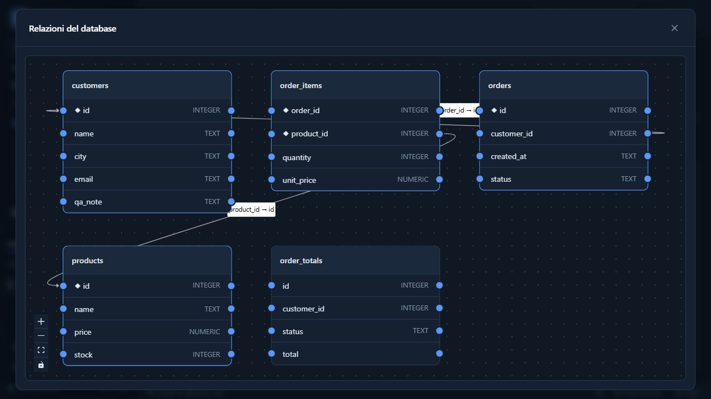
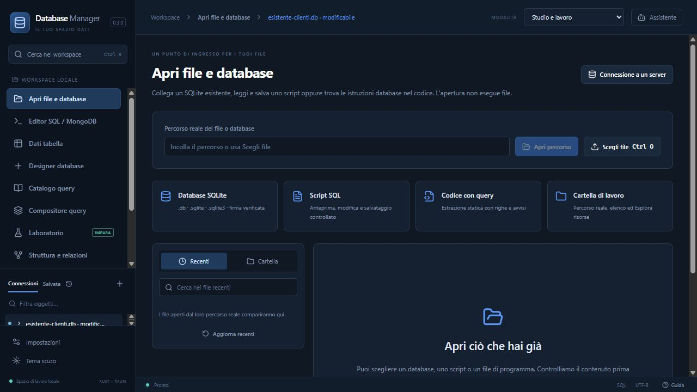
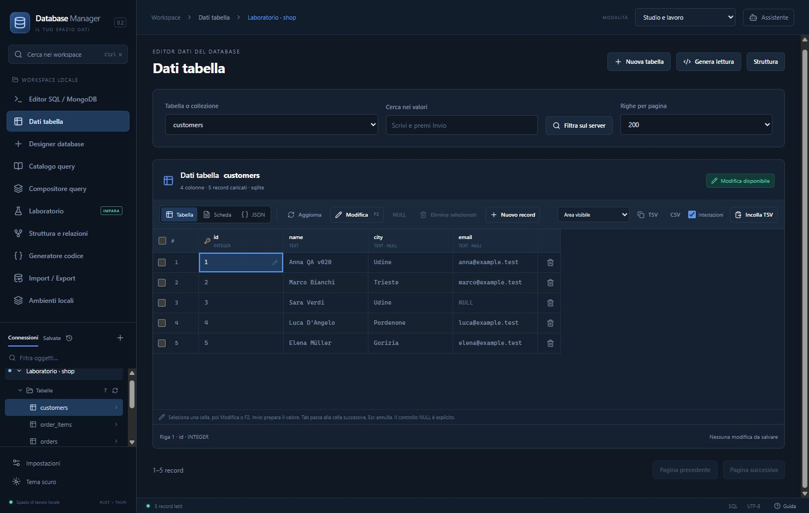
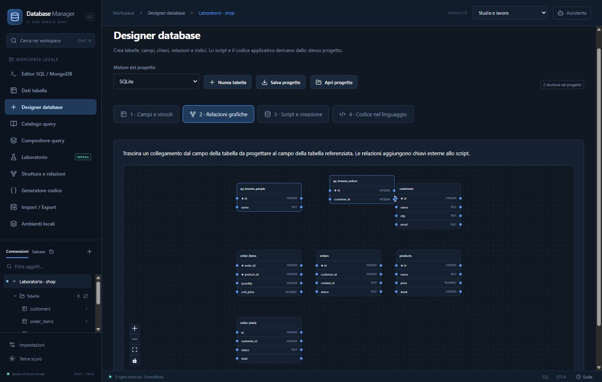
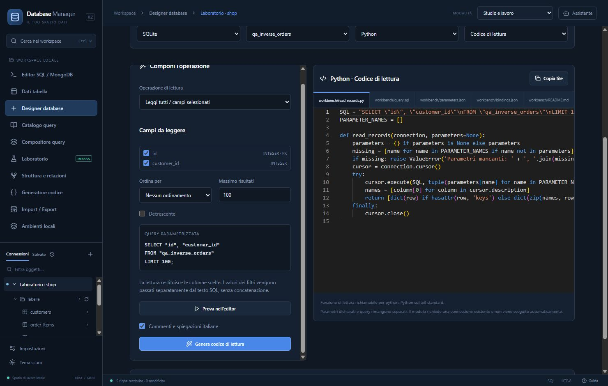

# Database Manager

Applicazione desktop in italiano per **SQLite, PostgreSQL, MySQL, MariaDB e MongoDB**, realizzata con **Rust, Tauri 2, React e TypeScript**.

Apri database e file già esistenti, prepara le query, modifica i dati con anteprima e genera codice per dodici linguaggi. I cataloghi separano esempi SQL/MongoDB e script PowerShell da leggere e personalizzare. Le funzioni principali e la guida didattica funzionano senza AI.

**Autore: Daniele Gabrovec** · **Versione 0.5.1** · **Distribuzione: Windows x64**

[**Scarica l'ultima release Windows**](https://github.com/danielegabrovec/Database-Manager/releases/latest) · [Guida utente](docs/GUIDA-UTENTE.md) · [Sviluppo](docs/SVILUPPO.md) · [Licenza](LICENSE)

La 0.5.1 completa apertura file e cataloghi, aggiunge piani di modifica dei database esistenti, guida PowerShell passo passo e funzioni di creazione dello schema nei dodici linguaggi. [Novità e limiti](docs/VERSIONE-0.5.md). La [patch 0.5.1](docs/VERSIONE-0.5.1.md) include la correzione di codifica verificata nella finestra Windows reale.

## Inizia in pochi minuti

1. Scarica l'installer `.exe` dalla pagina delle release e installa l'applicazione. È richiesto **Microsoft Edge WebView2**; il primo setup può richiedere la rete se il runtime manca.
2. Chiudi eventuali versioni precedenti prima di avviare la nuova: il programma mantiene una sola istanza.
3. Se hai già un file, scegli **Apri file e database** o `Ctrl+O`: SQLite esistente, script SQL e codice sorgente hanno azioni distinte. L'apertura non esegue SQL o programmi.
4. Per partire da esempi, apri **Laboratorio → SQLite → Negozio e ordini → Crea e apri laboratorio**. Per SQLite non serve un server.
5. Apri una tabella in **Dati tabella**, oppure prova questa query nell'**Editor SQL / MongoDB**:

```sql
SELECT c.name, SUM(i.quantity * i.unit_price) AS totale
FROM customers c
JOIN orders o ON o.customer_id = c.id
JOIN order_items i ON i.order_id = o.id
GROUP BY c.id, c.name
ORDER BY totale DESC;
```

`Ctrl+Invio` esegue la porzione scelta; `Ctrl+Spazio` completa nomi e funzioni. `Ctrl+O` apre un file e `Ctrl+Maiusc+O` sceglie una cartella. `Ctrl+S` salva il file della scheda, `Ctrl+Maiusc+S` apre Salva con nome, `Ctrl+W` chiude la scheda e `Ctrl+K` cerca nello spazio di lavoro. Le query personali si conservano separatamente con **Salva in libreria**.

## Un menu per attività

**Apri file e database**, **Editor SQL / MongoDB** e **Laboratorio** restano accessi diretti. Le altre aree sono raccolte in tre gruppi:

| Gruppo        | Contenuto                                                                  |
| ------------- | -------------------------------------------------------------------------- |
| **Database**  | Dati tabella, Struttura e relazioni, Designer database, Compositore query. |
| **Catalogo**  | **Catalogo PowerShell** e **Catalogo Query**.                              |
| **Strumenti** | Generatore codice, Import / Export, Ambienti locali.                       |

Un solo gruppo è aperto alla volta. Partendo da Apri file o Editor i gruppi sono chiusi; il primo clic su **Catalogo** mostra le due sottovoci. Il percorso in alto e **Indietro** (`Alt+Freccia sinistra`) aiutano a tornare all'area precedente. L'app ricorda l'ultima vista; i cataloghi mantengono filtri, selezione e parametri mentre passi ad altre aree nella stessa sessione.

**Catalogo Query** distingue **Esempi**, **Query salvate** e **Cronologia**. Ricerca e motore sono sempre visibili; **Filtri** apre categoria, livello o preferiti. Senza uno schema reale, gli esempi del dataset didattico sono dichiarati come tali.

**Catalogo PowerShell** contiene **52 modelli** per file/cartelle, diagnostica, cinque motori database, Docker e Ollama. Include creazione, CRUD sintetico e modifiche strutturali con simulazione `-WhatIf`. Ogni voce mostra parametri, effetti e prerequisiti. Puoi **Copiare**, **Aprire l'anteprima** o **Esportare .ps1**, senza eseguire comandi dall'app. L'esportazione usa UTF-8 con BOM per Windows PowerShell 5.1; client e servizi necessari vanno predisposti separatamente.

Il pulsante **Guida** apre **50 passi operativi e 77 esempi di query**, con ricerca, spiegazioni, comandi PowerShell e istruzioni per integrare il codice nelle applicazioni. La [guida completa](docs/GUIDA-OPERATIVA-POWERSHELL-QUERY.md) è consultabile anche fuori dall’app.

## Aprire file esistenti

| Origine                             | Flusso                                                                                                                                                                     |
| ----------------------------------- | -------------------------------------------------------------------------------------------------------------------------------------------------------------------------- |
| SQLite `.db`, `.sqlite`, `.sqlite3` | Verifica firma e metadati, poi collega il file in sola lettura iniziale o scegli esplicitamente la modalità modificabile. Un percorso mancante non crea un database vuoto. |
| Script SQL                          | Anteprima modificabile, codifica dichiarata, salvataggio con controllo delle modifiche esterne e apertura in una scheda query senza esecuzione automatica.                 |
| Codice dei dodici linguaggi         | Estrazione statica di istruzioni SQL/MongoDB, righe di origine e parametri da fornire. Le parti dinamiche restano bozze parziali, senza eseguire il programma.             |
| Cartella e recenti                  | **Scegli cartella…**, elenco con ricerca/paginazione, **Apri in Esplora risorse** e **Mostra file nella cartella**. Recenti riapribili per percorso reale.                 |

Le schede mantengono testo, parametri e modalità separati. Se il file cambia sul disco, il salvataggio conserva la bozza e segnala il conflitto. Per un database nuovo, **Nuova connessione → SQLite → Crea un nuovo database** rende esplicita l'intenzione di crearlo.

Il selettore grafico di cartella è disponibile nell'app desktop. L'anteprima browser dichiara questa differenza e permette di usare un percorso reale con il backend locale. I recenti conservano metadati locali del file; consulta [Privacy](PRIVACY.md).

I dump con `COPY FROM stdin`, direttive psql o `DELIMITER`/`SOURCE` MySQL richiedono il percorso **Importazione guidata nel database** e il client compatibile. Non vengono trattati come normali query del driver. Comandi punto di sqlite3 e separatori `GO` richiedono revisione; SQL Server non è un motore supportato.

## Dallo schema al codice

**Designer database → Campi e vincoli → Relazioni grafiche → Script e creazione → Codice nel linguaggio**.

Puoi disegnare anche senza connessione, salvare il progetto come JSON e generare sorgenti prima della creazione fisica. Per uno schema esistente usa **Designer → Carica schema esistente**, modifica campi o linee e rivedi **Script → Modifiche al database**. Il piano distingue operazioni, impatto sui dati e vincoli non migrabili automaticamente; verifica la destinazione prima dell’applicazione. Per letture applicative usa **Dati tabella → Genera lettura** e scegli colonne, filtri, JOIN o aggregazioni.

| Strumento                | Funzioni                                                                                                                                               |
| ------------------------ | ------------------------------------------------------------------------------------------------------------------------------------------------------ |
| Editor e catalogo        | SQL per dialetto, Extended JSON MongoDB, completamento dello schema e degli alias, esempi, parametri, query salvate, cronologia e spiegazioni offline. |
| Catalogo PowerShell      | 52 script parametrizzati, prerequisiti, anteprima, copia ed esportazione .ps1; nessuna esecuzione automatica.                                          |
| Centro file              | SQLite esistenti, script SQL, sorgenti, codifiche, recenti, cartelle e salvataggi verificati.                                                          |
| Dati tabella             | Selezione e modifica celle, copia TSV/CSV, incolla con anteprima, scheda/JSON, controllo tipi e conflitti, **Applica / Scarta**.                       |
| Designer                 | Nuove strutture e piani di modifica di tabelle esistenti; campi, indici e relazioni grafiche, anteprima e controllo dello schema. Diagramma espandibile. |
| Generatore               | Lettura, funzione parametrizzata, modello/DTO, repository, funzioni e programmi CRUD, funzioni di creazione schema SQL, API REST e script. Esportazione e VS Code. |
| Trasferimento e ambienti | Import/export, backup e ripristino con strumenti del motore; laboratori e istanze locali dedicate Docker o native.                                     |

**Linguaggi:** Rust, Python, JavaScript, TypeScript, PHP, Java, C#, C, C++, Go, Kotlin e Ruby. Le API REST sono per **Rust/Axum, Python/FastAPI e JavaScript/TypeScript/Fastify**.

I sorgenti generati comprendono istruzioni e dipendenze. Le credenziali vengono lette dall'ambiente; l'app non esegue automaticamente i programmi esportati.

## Anteprima

Diagramma espanso della 0.5, con dati sintetici:



Il nuovo ingresso file della 0.3.0:



Le schermate seguenti mostrano gli altri strumenti della revisione 0.2 su dati sintetici.



<details>
<summary>Designer e generazione del codice</summary>





</details>

## Verifiche e limiti attuali

La suite corrente passa **306 test frontend**. Le prove dedicate della 0.5 verificano migrazioni e contratto degli adattatori su **PostgreSQL, MySQL, MariaDB e MongoDB reali**, oltre a SQLite. Le nuove funzioni di creazione schema sono state generate per 48 combinazioni SQL e compilate/eseguite su SQLite nei **12 linguaggi**, senza modificare i sorgenti generati.

I parser reali di **Windows PowerShell 5.1 e PowerShell 7** verificano **57 script ciascuno**: 52 modelli iniziali e 5 casi con valori particolari, 114 analisi sintattiche. La sintassi non certifica l’esecuzione di tutti i comandi sui server.

Esiti della suite Rust, prove visive, installer e ambito della pubblicazione sono nel [report completo della 0.5](docs/REPORT-0.5.1-20261110.md). Le verifiche delle versioni precedenti restano nei rispettivi documenti.

- L'installer non è firmato digitalmente. La distribuzione qui documentata è **Windows x64**.
- Il piano grafico supporta modifiche dichiarate e blocca ricostruzioni che perderebbero metadati. Migrazioni complesse, PK/identità e alcuni vincoli richiedono SQL dedicato. Per PostgreSQL opera nello schema **public**.
- Le FK singole richiedono una destinazione PK/UNIQUE singola e completa. FK composte e indici parziali non vengono adottati dal designer fingendo di conservarli. Il generatore conserva il supporto alle PK composte.
- I repository di lettura restano distinti dalle funzioni/programmi CRUD. Le nuove funzioni di creazione schema riguardano i quattro motori SQL; per MongoDB si esporta lo schema JSON. Tipi non mappabili vengono segnalati.
- Anteprima testuale fino a 8 MiB; analisi sorgente del centro file fino a un milione di caratteri e 200 istruzioni, dichiarando le parti non analizzate. L'estrazione statica non ricostruisce ogni ORM o valore runtime.
- Server esterni, configurazioni TLS/SSH e installazione dei servizi Windows richiedono verifiche dedicate. I servizi SCM in VM pulita non sono certificati.

L'assistente facoltativo supporta Ollama o un endpoint HTTPS compatibile. Prima di abilitarlo consulta [Privacy](PRIVACY.md): query, schema e righe sono scelte di condivisione distinte, e le righe sono escluse inizialmente.

## Documentazione

| Documento                                              | Contenuto                                                          |
| ------------------------------------------------------ | ------------------------------------------------------------------ |
| [Guida utente](docs/GUIDA-UTENTE.md)                   | Installazione, dati, editor, designer, codice e flussi quotidiani. |
| [Guida PowerShell e query](docs/GUIDA-OPERATIVA-POWERSHELL-QUERY.md) | 50 passi, 77 esempi, creazione, apertura, modifica, backup e integrazione. |
| [Novità 0.5](docs/VERSIONE-0.5.md) | Migrazioni, recupero bozze, codice schema e limiti espliciti. |
| [Report 0.5](docs/REPORT-0.5.0-20261110.md) | Test correnti, prove visive, installer e distribuzione. |
| [Sviluppo](docs/SVILUPPO.md)                           | Toolchain, avvio locale, test e build Windows.                     |
| [Novità e verifiche 0.4](docs/VERSIONE-0.4.md)         | Navigazione, cataloghi, PowerShell e ambito delle prove correnti.  |
| [Novità e verifiche 0.3](docs/VERSIONE-0.3.md)         | Prove storiche: apertura file, schede, codifiche e salvataggi.     |
| [Piano apertura file](docs/PIANO-0.3-APERTURA-FILE.md) | Divari affrontati, scelte e criteri di accettazione.               |
| [Novità e verifiche 0.2](docs/VERSIONE-0.2.md)         | Prove storiche e limiti della precedente revisione funzionale.     |
| [Editor e libreria query](docs/QUERY-IDE.md)           | Completamento, catalogo, didattica e parametri.                    |
| [Architettura](docs/ARCHITETTURA.md)                   | Backend Rust, frontend e interfacce del progetto.                  |
| [Verifiche storiche 0.1](docs/VERIFICA.md)             | Collaudi precedenti, distinti dalle verifiche 0.3.                 |
| [Verifica dei generatori](docs/CODEGEN-VERIFICA.md)    | Matrice CRUD/REST, toolchain e ambito delle prove.                 |

Alcuni rapporti di sviluppo rimandano a registri locali di QA: tali registri, runtime temporanei e workspace non sono inclusi nel repository pubblico. Le istruzioni riproducibili sono nella guida di sviluppo.

## Autore e condizioni d'uso

**Daniele Gabrovec**. Consulta [AUTHORS.md](AUTHORS.md), [LICENSE](LICENSE), [LEGAL.md](LEGAL.md), [PRIVACY.md](PRIVACY.md) e [THIRD-PARTY-NOTICES.md](THIRD-PARTY-NOTICES.md). La presenza pubblica del repository non sostituisce le condizioni contenute in questi documenti. Le dipendenze e i motori database mantengono le rispettive licenze.
