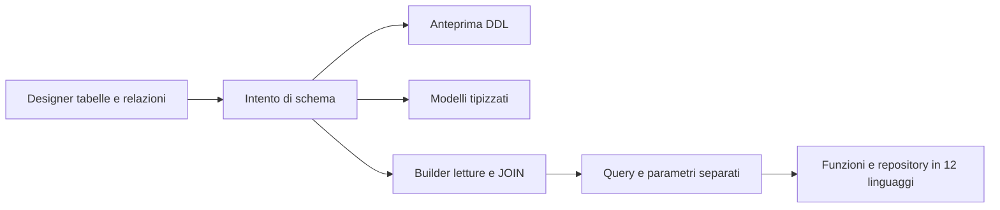

# Confronto con i gestori installati e scelte per Database Manager

Audit del 9 novembre 2026. Obiettivo: identificare interazioni utili e tradurle in funzioni originali del nostro software. Non sono stati letti profili utente, connessioni, credenziali o database personali; non è stato copiato codice dei prodotti nel programma.

## Identità e metodo

| Prodotto installato | Identità osservata | SHA-256 eseguibile |
|---|---|---|
| DBeaver 26.2.2 | `C:\Program Files\DBeaver\dbeaver.exe`; `.eclipseproduct`: snapshot `26.2.2-202610041844`, commit `8824e56` | `0b440e4117ee26c6eb47a1a060260d51da5eb71072a23e79b137402524d5b501` |
| pgAdmin 4 9.19 | `C:\Program Files\pgAdmin 4\runtime\pgAdmin4.exe`; `web/version.py`: release 9, revision 19 | `a4275787fa842cd07bedc17c9f85c5d10ab7443bd083fe5cd16ac6853a12253a` |

È stata usata REA 6.7.0 già disponibile. DBeaver è stato trattato come insieme di JAR: inventario del package SQL editor e lettura delle dichiarazioni `plugin.xml` dei moduli interessati. Per pgAdmin sono stati analizzati i JavaScript distribuiti nell'installazione, senza eseguirli: un primo gruppo di 3 sorgenti e un approfondimento di 4 sorgenti su 620 file rilevanti inventariati. **La copertura è parziale e statica**, non un collaudo dell'intera applicazione.

Riferimenti REA conservati:

- DBeaver SQL editor JAR: parent `ev_49d5ca6f20c471611d209c90339ec27bbd9d91dce03d519aedc9b21e01281deb`; inventario `ev_86b79752c7024340a22ca09f5d35c1efb127aadc7f33f783c7eb9f0176b7d0d7`. 607 membri, nessuna contraddizione d'integrità osservata.
- pgAdmin entrypoint ERD/SQL/table: parent `ev_6770986b0e310814c9942c59b25c5e683ebc1aee76979df82772ae2576da39c1`; 3 sorgenti selezionati.
- pgAdmin query/history/result editors: parent `ev_ee32711824a129288b0392091a5ac339debc771728418e7a4f726b7a6f9dc240`; 4 sorgenti selezionati, 100.640 byte letti, nessun errore di parsing; le dipendenze non selezionate restano sconosciute.

Le Evidence canoniche sono in `artifacts/rea-comparison/rea-evidence-bundle.json` e il catalogo delle dichiarazioni è in `artifacts/rea-comparison/dbeaver-declarations.json`. L'export contiene 7 record. Il salvataggio di uno snapshot nativo non è applicabile al target JAR senza un profilo di analisi nativo concreto: REA lo ha rifiutato; il bundle Evidence è stato salvato e la sessione è stata chiusa correttamente.

## Funzioni osservate e specifiche ricavate

| Area | Evidenza nei prodotti | Scelta concreta nel nostro software |
|---|---|---|
| Editor dati | Il plugin dati DBeaver dichiara presentazioni spreadsheet/plaintext, record mode, pannello valore, aggregati colonna e metadati; comandi copia/aggiunta riga, fetch pagina/tutto. Il [Data Editor ufficiale](https://dbeaver.com/docs/dbeaver/Data-Editor/) descrive navigazione e modifica dei risultati. | Griglia con selezione, filtri e ordinamento; copia TSV/JSON/SQL; editor del valore distinto dal testo visualizzato; NULL separato da stringa vuota. Il salvataggio mostra le modifiche in attesa e richiede una chiave stabile per identificare le righe. |
| Lettura dei risultati | pgAdmin distribuisce `ResultSetToolbar.jsx`, `CopyData` e controlli di intervallo/paginazione; la [Query Tool 9.19](https://www.pgadmin.org/docs/pgadmin4/9.19/query_tool.html) distingue risultati modificabili, messaggi, piani e cronologia. | Rendere chiara la provenienza di una riga e il numero effettivamente caricato. Non presentare la pagina corrente come conteggio totale. Risultati JOIN restano consultabili; la modifica richiede un'identità affidabile della riga. |
| Designer tabelle | Il `table.ui.js` distribuito importa schemi per colonne, PK, FK, UNIQUE e CHECK. Il [Table Dialog](https://www.pgadmin.org/docs/pgadmin4/9.19/table_dialog.html) mostra la DDL derivata dalle scelte grafiche. | Un progetto di schema modificabile anche senza connessione: tabelle, colonne, PK/FK e vincoli. Anteprima SQL separata dall'applicazione. Selezione di una tabella del progetto come ingresso del generatore di modelli e letture. |
| Relazioni/ERD | Il modulo ERD DBeaver dichiara editor, creazione e salvataggio diagrammi. pgAdmin documenta [ERD modificabile e generazione DDL](https://www.pgadmin.org/docs/pgadmin4/9.19/erd_tool.html). | Diagramma come rappresentazione dello stesso intento di schema del designer; FK esplicite e JOIN proposte sulle relazioni. La DDL e il codice applicativo devono usare nomi e tipi di quello schema, anche prima di creare un DB reale. |
| Editor query/catalogo | Il JAR SQL DBeaver dichiara esecuzione statement/script, nuovi risultati, EXPLAIN, parametri e template. `QueryHistory.jsx` è presente nella distribuzione pgAdmin. | Catalogo ricercabile di query, esempi per motore, preferiti e cronologia. Mostrare SQL e parametri separatamente; gli esempi non vengono eseguiti quando si selezionano o si copiano. |
| Completamento | La documentazione [SQL Assist](https://dbeaver.com/docs/dbeaver/SQL-Assist-and-Auto-Complete/) collega il completamento al contesto e ai metadati. Il package contiene famiglie di classi di completamento SQL; la loro presenza non dimostra da sola ogni comportamento runtime. | Suggerire tabelle/colonne dello schema attivo, parole chiave del dialetto e snippet. Il completamento non deve inventare oggetti quando i metadati non sono disponibili. |
| Query builder grafico | La documentazione DBeaver indica espressamente che il [Visual Query Builder](https://dbeaver.com/docs/dbeaver/Visual-Query-Builder/) è disponibile in Lite/Enterprise/Ultimate. **Non è stato attribuito alla copia installata soltanto perché esiste nella documentazione PRO.** | Builder originale per colonne, filtri tipizzati, JOIN, aggregazioni, ordine e paginazione; genera query parametrizzate. La query risultante alimenta direttamente il generatore di codice di lettura. |
| Codice applicativo | La sola generazione DDL non risolve il bisogno dell'utente di leggere e gestire dati nel proprio linguaggio. Questa è una scelta progettuale nostra, non una funzione attribuita ai package analizzati. | Percorso schema/relazioni → query di lettura → funzione/modello/repository/progetto. Dodici linguaggi; file, parametri, nomi originali e mapping tipi ispezionabili. Nessuna esecuzione automatica del codice generato. |

Le dichiarazioni di plugin e le importazioni sono **osservazioni del contenuto installato**; il comportamento descritto dalla documentazione è un secondo tipo di evidenza. Non è stata verificata in runtime la disponibilità di ogni azione, edizione, permesso o comportamento su tutti i motori dei prodotti confrontati.

## Collegamento al ciclo 0.2 di Database Manager

Il codice del ciclo corrente comprende `DataGrid`, `QueryLibraryView`/catalogo editor, `TableDesignerView` con progetto di schema offline e `CodegenView`/`codegen_workbench` per modelli e letture. Il workbench distingue i nuovi moduli richiamabili dai progetti CRUD/REST esistenti: non finge di legare parametri che il vecchio contratto non gestisce. Per PostgreSQL i nuovi moduli usano la query qualificata dello schema; i progetti legacy su schemi diversi da `public` danno un errore esplicito.

I test e le ricevute di QA del rilascio definiscono quali percorsi sono stati effettivamente compilati/eseguiti. La presenza del codice non equivale a equivalenza completa con DBeaver o pgAdmin.

Le estensioni successive più utili sono: anteprima delle modifiche di schema con confronto prima/dopo; pianificazione delle migrazioni con dipendenze; piani di esecuzione visuali per dialetto; navigazione guidata delle relazioni; mapping ORM dichiarato per singolo framework. Un parser bidirezionale di SQL arbitrario verso diagrammi richiede un progetto dedicato: non va simulato con sostituzioni o espressioni regolari.

## Identità degli artefatti selezionati

| Artefatto | SHA-256 |
|---|---|
| DBeaver `org.jkiss.dbeaver.ui.editors.sql_1.0.188.202610041844.jar` | `7391509635c8384e7519ca625b90b41d7729273a83461b2457a361efb6f41f84` |
| DBeaver `org.jkiss.dbeaver.ui.editors.data_1.0.188.202610041844.jar` | `83e030316d22950f5f8c0cf59af81aaefaeb780c3cc741d16942d7012fc927cc` |
| DBeaver `org.jkiss.dbeaver.ui.editors.erd_3.1.29.202610041844.jar` | `177493d0d86fefd74bc55704cc691ac7178e8054d4f1dd4b90f87e3e485c2fae` |
| pgAdmin `QueryHistory.jsx` | `dd62d172a00d1846c9908b6d1690a419aa34833eb0e34f45b0ceb2abc16b44b5` |
| pgAdmin `ResultSetToolbar.jsx` | `eefa6600673ba65f967a7e650671cfb33a61cf06bf0fef553bfa30040f213749` |
| pgAdmin `table.ui.js` | `b25ea77a7f29a5bd77be6e57a7a7f877165920762b5ad4abe6890c83f79425d2` |

I percorsi completi pgAdmin si trovano sotto `C:\Program Files\pgAdmin 4\web\pgadmin`: rispettivamente `tools/sqleditor/static/js/components/sections/` e `browser/server_groups/servers/databases/schemas/tables/static/js/`. Nessun programma è stato installato per eseguire questo audit.
